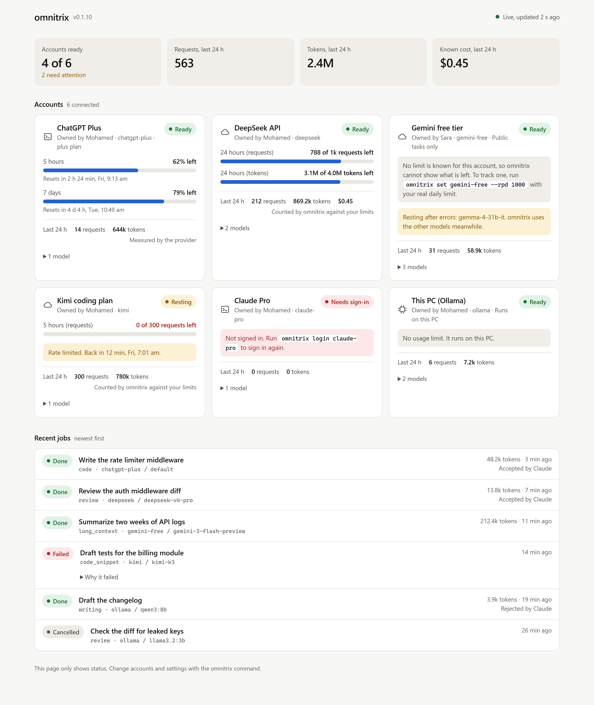

# omnitrix

Claude plans the work, and your other AI accounts carry it out.

<picture>
  <source media="(prefers-color-scheme: dark)" srcset="assets/job-v3-dark.svg">
  
</picture>

I built omnitrix because I repeatedly ran out of Claude credits while the ChatGPT Plus and Gemini subscriptions that my friends and I pay for remained largely unused.

omnitrix is built for the frontier-model subscriptions and API keys you already pay for, and it runs inside your existing Claude Code session. Claude remains in charge: it divides the job into tasks and reviews the results. omnitrix sends each task to an account that suits the work and still has quota available. For example, it can use Codex on your ChatGPT plan for code edits, Gemini for reading very large logs, DeepSeek or Kimi for reasoning and review, or a local model for private work. It also supports any service that implements the OpenAI or Anthropic API.

You can monitor the pool without leaving Claude Code. The status line shows up to four accounts with their remaining quota or status, and omnitrix instructs Claude to check the same data before it assigns work. Claude reads short results instead of performing every step itself, which uses less of your Claude usage limit.

## Installation

omnitrix requires Node.js 20 or later.

```bash
npm install -g https://github.com/MdHashim1011/omnitrix/releases/latest/download/omnitrix.tgz
```

## Quick start

```bash
omnitrix init
omnitrix init --apply
omnitrix setup-claude
```

`omnitrix init` lists the agent CLIs that omnitrix supports and finds on your PATH, the API keys set in the environment variables that `omnitrix providers` names (for example `DEEPSEEK_API_KEY`), and the local model servers that answer at their default addresses. It also shows which of them are already connected. Without `--apply`, it does not create or change anything. With `--apply`, it connects each new one in the same way as `omnitrix add <provider>` with no other options. It shows only the names of environment variables, never their values. For API keys, it stores a reference to the environment variable rather than the key itself, so the variable must also be set where Claude Code starts omnitrix.

It lists some tools without adding them: Claude Code, because Claude Code leads the work and would spend the same Claude quota as a worker; Google Antigravity, because Google has suspended accounts used through outside tools; and the Gemini CLI while `GEMINI_API_KEY` is not set, because it cannot run without a key. After `--apply`, CLI accounts that do not use an API key, such as Codex, OpenCode and Qwen Code, need `omnitrix login <id>` once before they can run jobs.

To connect accounts one at a time instead:

```bash
omnitrix providers
omnitrix add ollama
omnitrix add deepseek --key-env DEEPSEEK_API_KEY
omnitrix add codex --label "My ChatGPT Plus" --login
omnitrix test deepseek
omnitrix setup-claude
```

These commands list the available providers, add your local Ollama models and a DeepSeek key, sign in to Codex with your ChatGPT plan, confirm that DeepSeek responds, and register omnitrix with Claude Code as both an MCP server and a status line.

Restart Claude Code and give it a substantial task, such as "add tests for the billing module and document the API". Claude receives the omnitrix tools along with brief instructions on when to delegate work.

## How tasks are routed

<picture>
  <source media="(prefers-color-scheme: dark)" srcset="assets/routing-v3-dark.svg">
  
</picture>

Every task that Claude sends has a type, such as code, review or bulk work, and a privacy level. omnitrix first excludes any account that cannot accept the task at that moment because it is:

- disabled, signed out or banned in settings
- cooling down after a rate limit, offline, or out of quota for the current window
- not permitted to receive the task: private work never goes to an account that may train on prompts while private protection is on, and secret work goes only to local models
- unable to do the task, such as a model that cannot read images

A model that is resting after errors is skipped, while the account's other models remain available. An account that fails three times in a row within ten minutes, through network errors, server errors, timeouts or unknown errors, rests for ten minutes. Rate limits, exhausted quota and sign-in problems are handled separately and do not count towards this. When `pool_status` or the dashboard shows the pool, omnitrix also asks each local model server, such as Ollama, for its model list at most once every 30 seconds, and shows a server that does not answer as offline. The router then skips that server until it answers again. Server errors and timeouts that all come from one model only pause that model, so they do not rest an account that has other models.

Each remaining model receives a score based on how well it fits the task, how much quota the account has left, what the model costs, and how often its past work was accepted. An account that is already running as many jobs as its concurrency limit allows has its score halved. The highest-scoring model receives the task. If that call fails, omnitrix ranks the accounts again, skips those it has already tried, and passes the task on without any action from Claude. A job makes at most three attempts. A model that the provider no longer serves, or for which the plan has no allowance, is removed from the account and rests for 24 hours, and trying it does not count as an attempt.

Three further adjustments multiply that score. Each adjustment that applies is listed in the reasons shown by `omnitrix route`, which lists the top eight candidates, and by `route_preview`, which lists the top three:

- If a window that the provider reports with a reset time resets within the next hour, and the account still has at least 20% left in its tightest window, the score is multiplied by 1.25 so that the quota is used before it is lost. Windows that omnitrix counts itself have no reset time, so this applies only to providers that report their own windows, such as ChatGPT through Codex.
- If an account is forecast to run out of a window before it resets, as described under "Monitoring quota", the score is multiplied by 0.75 so that the account keeps some quota in reserve. This takes precedence over the previous adjustment.
- For a public task, a model with no price set, on an account that may train on prompts, has its score multiplied by 1.15. Such an account can only take public work, so giving it that work first leaves the other accounts' quota for private tasks. This does not apply in quality mode.

Together these adjustments can raise a score by about 44% or lower it by 25%, so they can change the order of models whose fit for the task is similar. A pin adds a large fixed amount, so in practice pinned accounts rank above all others, but the adjustments can change the order among pinned accounts.

Code tasks go only to agent CLIs that can edit files. Each task runs on a new branch in its own git worktree, so two workers never share a checkout.

An account's concurrency limit applies to all omnitrix processes on the same computer, such as the MCP server, the dashboard and the command line. A job waits in the queue until the account has a free slot. The limit does not apply across different computers.

A request to an API model may take up to 2 minutes for a small task, 5 minutes for a medium one and 10 minutes for a large one, and never longer than the job limit set with `omnitrix settings --timeout`. Agent CLIs such as Codex may use the whole job limit, because they work in many steps. When a model times out or returns a server error, only that model is paused for 5 minutes, and the job continues on other accounts or models.

Skill scores begin as an estimate based on the model's name. You can set them yourself, and omnitrix also adjusts its ranking over time: when Claude accepts or rejects a result, the model's record for that type of task is updated.

```bash
omnitrix models deepseek
omnitrix model deepseek deepseek-v4-pro --coding 9 --reasoning 9
omnitrix route --type review "check this diff for auth bugs"
```

## Monitoring quota

<picture>
  <source media="(prefers-color-scheme: dark)" srcset="assets/dashboard-4k-dark.png">
  
</picture>

<sub>The dashboard, shown with example data. Run `omnitrix dashboard` to open your own.</sub>

The dashboard shows each account's name, owner, usage in the last 24 hours and the quota remaining in each tracked window. In Claude Code, the status line gives a compact summary of up to four accounts. The Claude figures at the end appear when Claude Code provides them, which it does on Pro and Max plans:

```
omnitrix 5/6 ready · codex-main 38% · deepseek 788 left · kimi wait · groq-free 36% +2 │ Claude 5h 34% 7d 12%
```

Account percentages show the share remaining, and the Claude figures show the share used.

Most subscriptions neither publish exact limits nor provide a way to query the remaining allowance, so omnitrix states the source of each figure. For a ChatGPT plan, it queries Codex directly and shows the percentage remaining in each window that Codex reports, usually 5 hours and 7 days, along with the time each window resets. This query ignores any API key exported in your environment, so the figures always belong to the account's own plan. When a provider sends rate-limit headers, omnitrix reports the remaining requests in the status line and in `pool_status`. In all other cases, it counts the requests and tokens it has sent against the limits you configured. A `429` or `402` response from the provider pauses the account, whatever the count shows.

omnitrix also estimates when a window will run out if use continues at its current pace. For the windows that Codex reports for a ChatGPT plan, the pace is the share used between the opening of the window and the latest reading, and an estimate is possible once the window has been open for at least 15 minutes. For the 5-hour and 24-hour limits that omnitrix counts itself, the pace is the number of requests, or tokens, sent in the last hour, and an estimate is possible once at least three requests were sent in that hour. Weekly, monthly and one-minute limits are not estimated, because a single hour says little about them. An estimate is shown only when it falls before the window resets or, for a rolling window, within the length of the window. The estimate is a straight-line projection that does not account for older use leaving a rolling window, so it is a warning rather than a prediction. In `pool_status` it reads, for example, "runs out in about 1 h 7 min at this pace", and the dashboard shows "At this pace it runs out in about 1 h 7 min", followed by the time.

## Privacy

Tasks are `private` by default, which keeps them away from accounts flagged as possibly training on prompts. omnitrix flags Mistral and the Gemini API by default, and you can flag any other account with `omnitrix set <id> --trains-on-data`. A task marked `secret` runs only on local providers such as Ollama. omnitrix sends data only to the providers you connect, and it collects no telemetry.

## Connecting accounts

| Account type | Command |
|---|---|
| ChatGPT plan through Codex | `omnitrix add codex --login` |
| Your own Claude subscription | `omnitrix add claude-code --login` |
| An API key | `omnitrix add kimi --key-env MOONSHOT_API_KEY` |
| Gemini | `omnitrix add gemini --key-env GEMINI_API_KEY` with a key from Google AI Studio. A Google AI Pro sign-in works only through `antigravity`, which is experimental. |
| A coding plan (GLM, Kimi, MiniMax) | `omnitrix add claude-code --base-url https://api.z.ai/api/anthropic --key-env ZAI_API_KEY` |
| A local model | `omnitrix add ollama` (LM Studio, llama.cpp and vLLM are also supported) |
| Any other service | `omnitrix add custom-openai --base-url https://host/v1 --key-env MY_KEY --model my-model` |

Run `omnitrix providers` for the full list. Each CLI account has its own profile folder, so two Codex logins never mix. Keys are stored in `~/.omnitrix/secrets.json`. If you use `--key-env`, omnitrix does not store the key at all.

To track a limit, specify it when you add the account or later with `omnitrix set`:

```bash
omnitrix set codex-main --r5h 120        # requests per 5 hours
omnitrix set groq-free --rpm 30 --rpd 1000
omnitrix set deepseek --tpd 4000000      # tokens per day
```

The available options are `--rpm` (requests per minute), `--r5h` (requests per 5 hours), `--rpd` (requests per day), `--rpw` (requests per week), `--tpd` (tokens per day) and `--tpm` (tokens per month).

## Team mode

A company that pays for API usage can share its accounts with every developer through one team file, so that each developer's Claude Code can use them without buying extra credits. The file lists the shared API accounts, the price of each model and the budgets. It never contains keys: each account names the environment variable that holds the key on each developer's computer.

```json
{
  "version": 1,
  "name": "Acme",
  "accounts": [
    { "id": "acme-openai", "provider": "openai", "keyEnv": "ACME_OPENAI_KEY", "models": ["gpt-5.2"], "usdPerDay": 40 }
  ],
  "prices": { "gpt-5.2": { "input": 1.25, "output": 10 } },
  "budgets": { "usdPerDay": 5, "usdPerMonth": 60, "people": { "lead@acme.com": { "usdPerDay": 20 } } },
  "auditDir": "//fileserver/omnitrix-audit"
}
```

Prices are in US dollars per million tokens. On Windows, `auditDir` can be a network path such as `//fileserver/omnitrix-audit`; on macOS and Linux, use the folder where the share is mounted, such as `/Volumes/omnitrix-audit` or `/mnt/omnitrix-audit`.

```bash
omnitrix team join ./omnitrix.team.json
omnitrix team join ./omnitrix.team.json --yes <review code>
omnitrix team
omnitrix usage --by person
```

The first command changes nothing. It shows each shared account, the server that its key would be sent to, whether the key's environment variable is set on this computer, any team limit on the account, your budget and the shared folder, together with a short review code. It warns when a server is not the provider's own address, when an account uses a variable that usually holds a personal key, such as `OPENAI_API_KEY`, and when a model has no price. The second command joins the team, and it works only with the review code of the exact contents that were shown, so a file that was edited in between is refused.

You are identified by the email address in your global git configuration, or by your login name if none is set; use `--as <name>` to choose another name. Names in the team file must match exactly, including capital letters, and omnitrix does not verify them. `omnitrix team` shows what you have spent today and this month, and `omnitrix team leave` stops using the file.

omnitrix records the contents of the file when you join. If the file changes later, for example when someone adds an account or changes a server address, its accounts stop loading until you review and join it again. A team file is refused if an account has a field named like a key (such as `apiKey`, `key`, `secret`, `token`, `password` or `authorization`), names a CLI provider such as Codex, Claude Code or Gemini CLI, names a local model server, or has a `baseUrl` that is not a valid `https://` address. It is also refused if an account takes its key from a variable for another kind of credential (for example `AWS_*`, `GITHUB_TOKEN` or a password), sends a variable that usually holds a personal key to a server other than the provider's own, or marks a provider that may train on prompts as safe for private work. omnitrix does not inspect the values of other fields, so a team file should still be checked for pasted keys.

Team accounts are loaded from the file each time and are never saved into your own configuration. For this reason, `omnitrix set`, `enable`, `disable`, `remove`, `model` and `models --refresh` refuse to change them. If you already have an account with the same id, your own account is used, and team budgets never apply to it.

Each request that omnitrix sends to a team account, including `omnitrix test`, is recorded with your name, the team, the account, the model, the tokens, the cost, the time and the job id. When the provider does not report the cost, omnitrix estimates it from the prices in the file; a model without a price counts as costing nothing, so every team model should have one. When your daily or monthly budget is used up, the router skips the team's accounts, and your own accounts and local models still work. A person can have their own budget under `people`. An account can also have a limit for the whole team, `usdPerDay` or `usdPerMonth`. Days and months follow each computer's local time. If budgets cannot be worked out, the team's accounts are skipped rather than used.

When the file names an `auditDir`, the records of your requests on team accounts are also copied to that shared folder, in one file per person. These records hold no prompts or results. omnitrix then counts everyone's spending against the account limits, and `omnitrix usage --team` reports on the whole team. Records that are malformed, that do not belong to the file they are in, or that are dated in the future are ignored, and links, folders and files larger than 10 MB in the shared folder are skipped. Other developers' spending is read from the folder at most once a minute; your own spending counts at once. If the folder cannot be reached, account limits count only your own spending, and `pool_status` says so.

While a request on a team account is running, its largest possible cost, estimated from its prompt and its output limit, counts against your budget and the account's limit in the omnitrix process that sends it, so a burst of requests from one process cannot run far past either. Requests running in other omnitrix processes or on other computers are counted only once their records exist. A request can still cost more than its estimate when its prompt includes large files. Your personal budget counts only the requests made from this computer, and anyone who can write to the shared folder can affect the account limits. Budgets are therefore safeguards rather than strict enforcement; a provider's own spending limit on the company account remains the most reliable protection, and a team should set one as well.

Personal subscriptions cannot be team accounts, because a seat on a plan such as ChatGPT Plus or Claude Pro belongs to one person.

## MCP tools

omnitrix runs as an MCP server and gives Claude the following tools:

| Tool | Purpose |
|---|---|
| `pool_status` | Lists every account with its state, owner, models and remaining quota |
| `route_preview` | Shows which account would receive each task, and why, without running anything |
| `dispatch` | Sends up to 30 tasks at once and runs independent tasks in parallel |
| `get_results` | Waits for jobs and returns a short preview of each result |
| `read_output` | Reads a full result in pages when the preview is not sufficient |
| `rate_result` | Accepts or rejects a result so that the router can learn from it, and can send a rejected task to another model |
| `cancel_job`, `list_jobs` | Cancels a job or lists recent jobs |

The `pool_status`, `dispatch` and `get_results` tools declare output schemas, and their structured data contains everything their text shows. `list_jobs` also lists jobs that other omnitrix processes started, and `cancel_job` can cancel them.

A task can set `effort` to `low`, `medium` or `high` to ask a reasoning model to think less or more. omnitrix passes it to Codex and to OpenAI-compatible APIs such as Gemini; without it, each provider uses its own default. From the command line, use `omnitrix run --effort high`.

### Checking and retrying results

A task can set `check` to `true` together with an `acceptance` line. When the result is ready, omnitrix sends a short review task to a different account. That task contains the instructions, the acceptance line and the result, with secrets removed and the result marked as data rather than instructions, and asks for PASS or FAIL with a one-sentence reason. Checks run only on models without tools, never on an agent CLI that can read files or run commands. `get_results` waits for this verdict and shows it next to the result. The check follows the privacy level of the task, so private work is checked only by an account that may receive private work. If no other suitable account is available, the check is reported as unavailable. The check uses the checking account's quota, and it reads the worker's report, not the changed files. It is advice for Claude's own review and does not replace it.

When Claude rejects a result, it can call `rate_result` with `retry` set to `true` and a note that explains what was wrong. omnitrix then sends the same task to a model that has not been rejected for it, with the note added to the instructions. The new worker sees the note but not the rejected answer.

By default, previews are limited to 1,500 characters to keep Claude's token usage low; `omnitrix settings --preview-chars` changes the limit. Full outputs remain on disk.

## Commands

```
omnitrix init                   list what can be connected on this computer (--apply connects it)
omnitrix providers              list the providers you can connect
omnitrix add <provider>         connect an account
omnitrix login <id>             sign in a CLI account in its own profile
omnitrix list                   show accounts, usage and remaining quota
omnitrix test <id>              send a small request to check an account
omnitrix set <id>               change limits, owner, key or concurrency
omnitrix enable|disable <id>    enable or disable an account
omnitrix remove <id>            remove an account (--purge also deletes its login)
omnitrix models <id>            show model scores (--refresh queries the provider again)
omnitrix model <id> <model>     set scores or prices, or --add or --remove a model
omnitrix route <prompt>         show which model would receive a task
omnitrix run <prompt>           run one task and print the answer
omnitrix settings               set the mode, privacy, and pinned or banned providers
omnitrix dashboard              open a live web dashboard on 127.0.0.1
omnitrix setup-claude           register with Claude Code
omnitrix team                   join, review or leave a team file, and show your spending
omnitrix usage                  requests, tokens and cost by person, account or model for the last 30 days (--team reads the shared folder)
omnitrix clean                  delete finished jobs and worktrees older than 14 days (--branches also deletes branches no longer needed)
omnitrix doctor                 check the setup
```

`omnitrix clean --branches` also deletes the git branch of each old job that was rejected, failed or cancelled, and the branch of any other old job once its work is already in the repository's current branch. A branch with work that has not been merged is kept, together with its job record, so that a later `clean --branches` can still remove it once it is merged or rejected. Only branches that omnitrix created for its jobs are deleted. Add `--dry-run` to see what would be deleted first; it changes nothing.

`omnitrix settings --mode saver` prefers free and low-cost models, `--mode quality` prefers the strongest models, and `--pin code=codex-main` tries that account first for code tasks whenever it is eligible.

## Provider terms

omnitrix uses only official CLIs and APIs with credentials that you enter yourself. It provides no means of importing another person's login.

OpenAI, Google and Anthropic all prohibit sharing a consumer account, so connect only accounts that you own. A friend who wishes to contribute should use an API key billed to them. Anthropic permits Claude subscriptions for ordinary individual use only. Google has suspended accounts that used Antigravity sign-in through third-party tools, so omnitrix marks Antigravity as experimental and recommends Gemini API keys instead. Free tiers are often limited per organization, so additional keys from the same organization provide no extra quota.

omnitrix is an independent project. It is not affiliated with OpenAI, Google, Anthropic or any other AI provider, or with Cartoon Network and Warner Bros. Discovery. Product names and trademarks belong to their respective owners.

## Current limitations

Remaining quota is measured for ChatGPT plans. For other subscriptions it is an estimate, because those providers do not offer an API for it. The Codex and Claude Code drivers depend on the current flags of those tools and may need updating when the flags change. The other agent CLIs have been tested less thoroughly than Codex.

## Roadmap

The next planned feature is friend nodes. A friend would run a small agent on their own computer with their own login and a daily cap that they can pause at any time, so their account never leaves their machine. Later plans include drivers for Aider and Goose.

## Development

```bash
git clone https://github.com/MdHashim1011/omnitrix.git
cd omnitrix
npm install
npm run build
npm test
```

The tests use fake providers and a fake agent CLI, so they require neither API keys nor network access.

## License

Apache-2.0. Copyright 2026 Mohamed Hashim.
