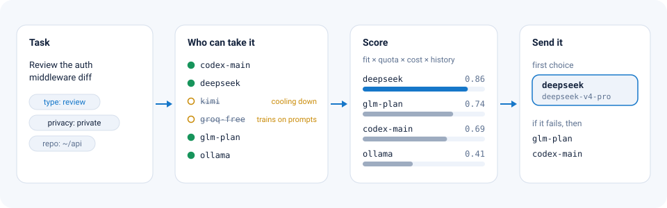
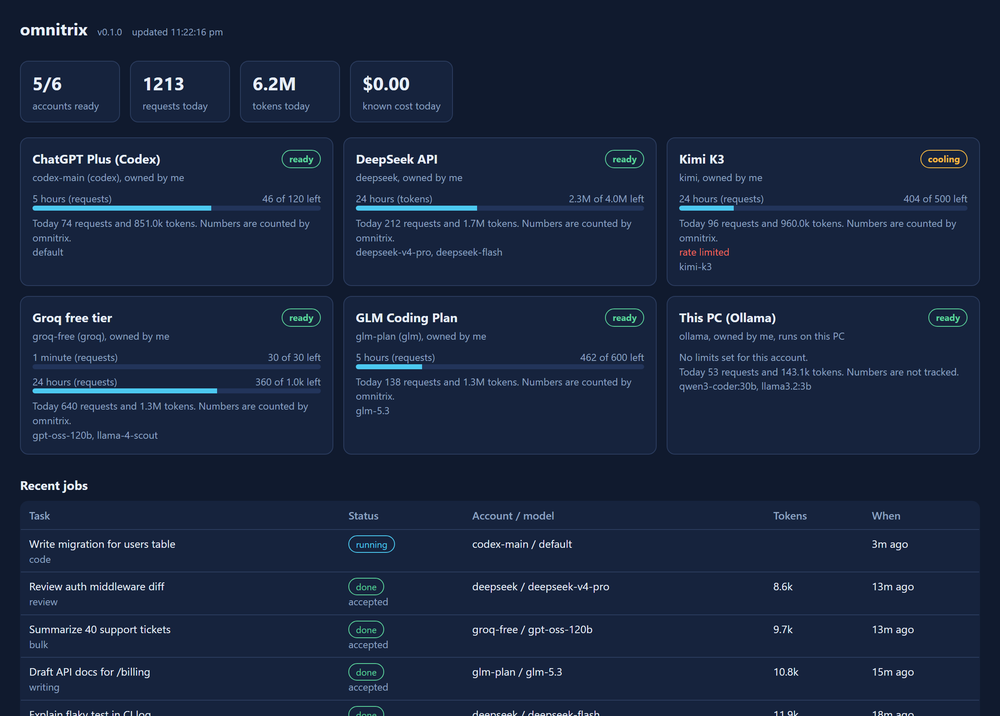

# omnitrix

Claude plans the work. Your other AI accounts do it.

<picture>
  <source media="(prefers-color-scheme: dark)" srcset="assets/hero-dark.svg">
  
</picture>

I kept running out of Claude credits while my ChatGPT Plus subscription, and the ones my friends pay for, sat mostly unused. omnitrix is how I fixed that.

Claude Code stays in charge. It breaks the job into tasks and checks what comes back. omnitrix sends each task to whichever of your other accounts suits it and still has quota left. That might be Codex on your ChatGPT plan, a DeepSeek or Kimi API key, Groq's free tier or a model on your own PC. Anything that speaks the OpenAI or Anthropic API works too.

Claude only reads short results instead of doing every step itself, so your Claude limit goes a lot further.

## Install

You need Node.js 20 or newer.

```bash
npm install -g github:MdHashim1011/omnitrix
```

## Quick start

```bash
omnitrix providers
omnitrix add ollama
omnitrix add deepseek --key-env DEEPSEEK_API_KEY
omnitrix add codex --label "My ChatGPT Plus" --login
omnitrix test deepseek
omnitrix setup-claude
```

That lists what you can connect, adds your local Ollama models and a DeepSeek key, signs in to Codex with your ChatGPT plan, checks that DeepSeek answers, and registers omnitrix with Claude Code (the MCP server plus the status line).

Restart Claude Code and give it something big, like "add tests for the billing module and document the API". It sees the omnitrix tools and a short playbook on when to hand work out.

## How a task finds its model

<picture>
  <source media="(prefers-color-scheme: dark)" srcset="assets/routing-dark.svg">
  
</picture>

Every task Claude sends has a type, like code, review or bulk work, and a privacy level. omnitrix first sets aside any account that can't take it right now:

- switched off or logged out
- cooling down after a rate limit
- out of quota for the current window
- not allowed to see private work

The rest get a score from four things: how well the model fits the task, how much quota is left, what it costs, and how often its past work was accepted. The best one gets the task. If that call fails, the next one in line takes over and Claude never has to step in.

Code tasks only go to agent CLIs that can edit files, and each one runs in its own git worktree on a new branch, so two workers never touch the same checkout.

The skill scores start as a guess from the model's name. You can set them yourself, and omnitrix also learns: when Claude accepts or rejects a result, that model's record for that kind of task moves up or down.

```bash
omnitrix models deepseek
omnitrix model deepseek deepseek-v4-pro --coding 9 --reasoning 9
omnitrix route --type review "check this diff for auth bugs"
```

## Seeing what's left



<sub>The dashboard, shown here with example data. Run `omnitrix dashboard` to open yours.</sub>

Each account shows its name, who owns it, what it has used today and what's left in each window you've set. Inside Claude Code the same numbers sit in the status line:

```
omnitrix 5/6 ready · codex-main 38% · deepseek 788 left · kimi wait · groq-free 36% │ Claude 5h 34% 7d 12%
```

Most subscriptions don't publish exact limits or offer a way to ask how much is left, so omnitrix tells you where each number comes from. When a provider sends rate-limit headers, you see those. Otherwise omnitrix counts the requests and tokens it sent against the limits you gave it. A `429` or `402` from the provider always wins over the count.

## Privacy

Tasks are `private` by default, which keeps them away from providers that may train on prompts (several free tiers do). Mark a task `secret` and it only runs on models on your own machine. Nothing else leaves your computer except the requests to the providers you connected, and there's no telemetry.

## Connecting accounts

| What you have | How to add it |
|---|---|
| ChatGPT plan through Codex | `omnitrix add codex --login` |
| Your own Claude subscription | `omnitrix add claude-code --login` |
| An API key | `omnitrix add kimi --key-env MOONSHOT_API_KEY` |
| A coding plan (GLM, Kimi, MiniMax) | `omnitrix add claude-code --base-url https://api.z.ai/api/anthropic --key-env ZAI_API_KEY` |
| A model on your PC | `omnitrix add ollama` (also LM Studio, llama.cpp, vLLM) |
| Anything else | `omnitrix add custom-openai --base-url https://host/v1 --key-env MY_KEY --model my-model` |

Run `omnitrix providers` for the full list. Each CLI account gets its own profile folder, so two Codex logins never mix. Keys are stored in `~/.omnitrix/secrets.json`, or not at all if you use `--key-env`.

To track a limit, pass it when you add the account or later with `omnitrix set`:

```bash
omnitrix set codex-main --r5h 120        # requests per 5 hours
omnitrix set groq-free --rpm 30 --rpd 1000
omnitrix set deepseek --tpd 4000000      # tokens per day
```

The full set is `--rpm`, `--r5h`, `--rpd`, `--rpw`, `--tpd` and `--tpm`.

## What Claude gets

omnitrix runs as an MCP server. Claude sees these tools:

| Tool | What it does |
|---|---|
| `pool_status` | Every account with its state, owner, models and remaining quota |
| `route_preview` | Who would get each task, and why, without running anything |
| `dispatch` | Sends up to 30 tasks at once; independent ones run in parallel |
| `get_results` | Waits for jobs and returns a short preview of each result |
| `read_output` | Pages through a full result when the preview isn't enough |
| `rate_result` | Accepts or rejects a result so the router learns |
| `cancel_job`, `list_jobs` | Job housekeeping |

Previews are capped at 1,500 characters so reading them costs Claude very little. Full outputs stay on disk.

## Commands

```
omnitrix providers              providers you can connect
omnitrix add <provider>         connect an account
omnitrix login <id>             sign in a CLI account in its own profile
omnitrix list                   accounts, usage and what's left
omnitrix test <id>              send a tiny request to check an account
omnitrix set <id>               change limits, owner, key or concurrency
omnitrix enable|disable <id>    switch an account on or off
omnitrix remove <id>            remove an account (--purge also deletes its login)
omnitrix models <id>            model scores (--refresh asks the provider again)
omnitrix model <id> <model>     set scores or prices, --add or --remove a model
omnitrix route <prompt>         show which model would get a task
omnitrix run <prompt>           run one task and print the answer
omnitrix settings               mode, privacy, pinned and banned providers
omnitrix dashboard              live web dashboard on 127.0.0.1
omnitrix setup-claude           register with Claude Code
omnitrix clean                  delete old jobs and worktrees (branches stay)
omnitrix doctor                 check the setup
```

`omnitrix settings --mode saver` prefers free and cheap models, `--mode quality` prefers the strongest ones, and `--pin code=codex-main` always tries that account first for code.

## Provider rules

omnitrix only drives official CLIs and APIs with credentials you entered yourself. It has no way to import someone else's login, and it won't get one.

OpenAI, Google and Anthropic all forbid sharing a consumer account, so connect accounts you own. If a friend wants to chip in, the clean way is an API key billed to them. Anthropic allows Claude subscriptions for ordinary individual use only. Google has suspended accounts that used Antigravity sign-in through outside tools, which is why omnitrix marks Antigravity as experimental and points you to Gemini API keys instead. Free tiers often limit per organization, so extra keys from the same org add nothing.

omnitrix is an independent project. It isn't affiliated with OpenAI, Google, Anthropic or any other AI provider, or with Cartoon Network and Warner Bros. Discovery. Product names and trademarks belong to their owners.

## What it can't do yet

Remaining quota on subscription plans is an estimate, because the big providers don't offer an API for it. The Codex and Claude Code drivers follow those tools' current flags and may need an update when they change. The other agent CLIs are less tested than Codex.

Next on my list is friend nodes. A friend would run a small agent on their own computer with their own login and a daily cap they can pause at any time, so their account never leaves their machine. After that I want a second model to double-check critical results, and drivers for Aider and Goose.

## Development

```bash
git clone https://github.com/MdHashim1011/omnitrix.git
cd omnitrix
npm install
npm test
```

The tests use fake providers and a fake agent CLI, so they need no keys and no network.

## License

Apache-2.0. Copyright 2026 Mohamed Hashim.
