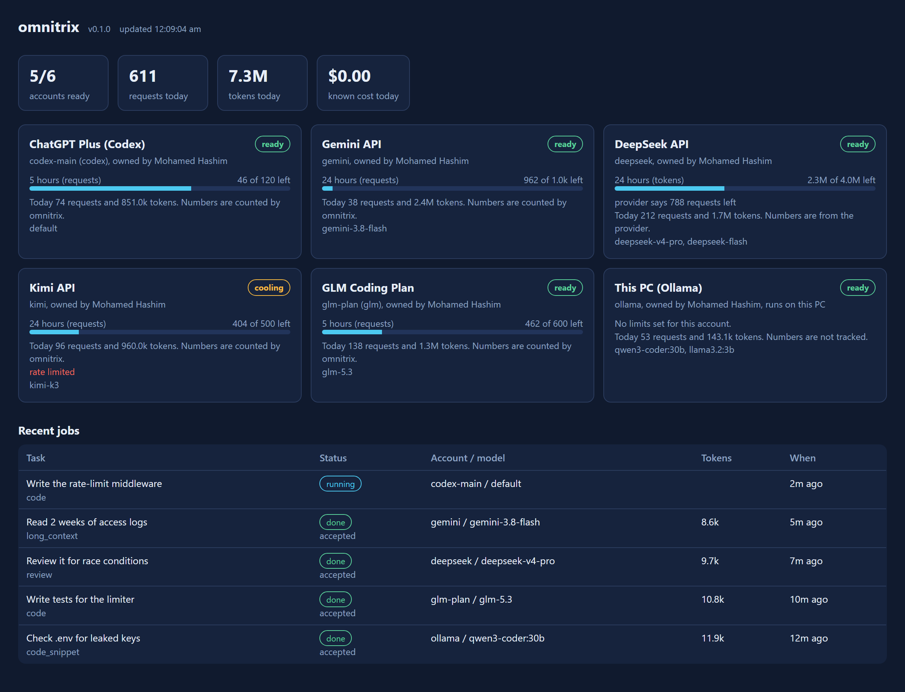

# omnitrix

Claude plans the work, and your other AI accounts carry it out.

<picture>
  <source media="(prefers-color-scheme: dark)" srcset="assets/job-dark.svg">
  
</picture>

I built omnitrix because I repeatedly ran out of Claude credits while the ChatGPT Plus and Gemini subscriptions that my friends and I pay for remained largely unused.

omnitrix is built for the frontier-model subscriptions and API keys you already pay for, and it runs inside your existing Claude Code session. Claude remains in charge: it divides the job into tasks and reviews the results. omnitrix sends each task to an account that suits the work and still has quota available. For example, it can use Codex on your ChatGPT plan for code edits, Gemini for reading very large logs, DeepSeek or Kimi for reasoning and review, or a local model for private work. It also supports any service that implements the OpenAI or Anthropic API.

You can monitor the pool without leaving Claude Code. The status line shows up to four accounts with their remaining quota or status, and omnitrix instructs Claude to check the same data before it assigns work. Claude reads short results instead of performing every step itself, which uses less of your Claude usage limit.

## Installation

omnitrix requires Node.js 20 or later.

```bash
npm install -g https://github.com/MdHashim1011/omnitrix/releases/latest/download/omnitrix.tgz
```

## Quick start

```bash
omnitrix providers
omnitrix add ollama
omnitrix add deepseek --key-env DEEPSEEK_API_KEY
omnitrix add codex --label "My ChatGPT Plus" --login
omnitrix test deepseek
omnitrix setup-claude
```

These commands list the available providers, add your local Ollama models and a DeepSeek key, sign in to Codex with your ChatGPT plan, confirm that DeepSeek responds, and register omnitrix with Claude Code as both an MCP server and a status line.

Restart Claude Code and give it a substantial task, such as "add tests for the billing module and document the API". Claude receives the omnitrix tools along with brief instructions on when to delegate work.

## How tasks are routed

<picture>
  <source media="(prefers-color-scheme: dark)" srcset="assets/routing-v2-dark.svg">
  
</picture>

Every task that Claude sends has a type, such as code, review or bulk work, and a privacy level. omnitrix first excludes any account that cannot accept the task at that moment because it is:

- disabled or signed out
- cooling down after a rate limit
- out of quota for the current window
- not permitted to receive private work

Each remaining account receives a score based on four factors: how well the model fits the task, how much quota remains, what the model costs, and how often its past work was accepted. The highest-scoring account receives the task. If that call fails, the next account in the ranking takes over without any action from Claude.

Code tasks go only to agent CLIs that can edit files. Each task runs on a new branch in its own git worktree, so two workers never share a checkout.

Skill scores begin as an estimate based on the model's name. You can set them yourself, and omnitrix also adjusts its ranking over time: when Claude accepts or rejects a result, the model's record for that type of task is updated.

```bash
omnitrix models deepseek
omnitrix model deepseek deepseek-v4-pro --coding 9 --reasoning 9
omnitrix route --type review "check this diff for auth bugs"
```

## Monitoring quota



<sub>The dashboard, shown with example data. Run `omnitrix dashboard` to open your own.</sub>

The dashboard shows each account's name, owner, usage today and the quota remaining in each tracked window. In Claude Code, the status line gives a compact summary of up to four accounts. The Claude figures at the end appear when Claude Code provides them, which it does on Pro and Max plans:

```
omnitrix 5/6 ready · codex-main 38% · deepseek 788 left · kimi wait · groq-free 36% │ Claude 5h 34% 7d 12%
```

Most subscriptions neither publish exact limits nor provide a way to query the remaining allowance, so omnitrix states the source of each figure. For a ChatGPT plan, it queries Codex directly and shows the percentage remaining in the 5-hour and 7-day windows, along with the time each window resets. When a provider sends rate-limit headers, omnitrix displays those values. In all other cases, it counts the requests and tokens it has sent against the limits you configured. A `429` or `402` response from the provider always overrides the count.

## Privacy

Tasks are `private` by default, which keeps them away from accounts flagged as possibly training on prompts. omnitrix flags Mistral and the Gemini API by default, and you can flag any other account with `omnitrix set <id> --trains-on-data`. A task marked `secret` runs only on local providers such as Ollama. omnitrix sends data only to the providers you connect, and it collects no telemetry.

## Connecting accounts

| Account type | Command |
|---|---|
| ChatGPT plan through Codex | `omnitrix add codex --login` |
| Your own Claude subscription | `omnitrix add claude-code --login` |
| An API key | `omnitrix add kimi --key-env MOONSHOT_API_KEY` |
| Gemini | `omnitrix add gemini --key-env GEMINI_API_KEY` with a key from Google AI Studio. A Google AI Pro sign-in works only through `antigravity`, which is experimental. |
| A coding plan (GLM, Kimi, MiniMax) | `omnitrix add claude-code --base-url https://api.z.ai/api/anthropic --key-env ZAI_API_KEY` |
| A local model | `omnitrix add ollama` (LM Studio, llama.cpp and vLLM are also supported) |
| Any other service | `omnitrix add custom-openai --base-url https://host/v1 --key-env MY_KEY --model my-model` |

Run `omnitrix providers` for the full list. Each CLI account has its own profile folder, so two Codex logins never mix. Keys are stored in `~/.omnitrix/secrets.json`. If you use `--key-env`, omnitrix does not store the key at all.

To track a limit, specify it when you add the account or later with `omnitrix set`:

```bash
omnitrix set codex-main --r5h 120        # requests per 5 hours
omnitrix set groq-free --rpm 30 --rpd 1000
omnitrix set deepseek --tpd 4000000      # tokens per day
```

The available options are `--rpm` (requests per minute), `--r5h` (requests per 5 hours), `--rpd` (requests per day), `--rpw` (requests per week), `--tpd` (tokens per day) and `--tpm` (tokens per month).

## MCP tools

omnitrix runs as an MCP server and gives Claude the following tools:

| Tool | Purpose |
|---|---|
| `pool_status` | Lists every account with its state, owner, models and remaining quota |
| `route_preview` | Shows which account would receive each task, and why, without running anything |
| `dispatch` | Sends up to 30 tasks at once and runs independent tasks in parallel |
| `get_results` | Waits for jobs and returns a short preview of each result |
| `read_output` | Reads a full result in pages when the preview is not sufficient |
| `rate_result` | Accepts or rejects a result so that the router can learn from it |
| `cancel_job`, `list_jobs` | Cancels a job or lists recent jobs |

By default, previews are limited to 1,500 characters to keep Claude's token usage low; `omnitrix settings --preview-chars` changes the limit. Full outputs remain on disk.

## Commands

```
omnitrix providers              list the providers you can connect
omnitrix add <provider>         connect an account
omnitrix login <id>             sign in a CLI account in its own profile
omnitrix list                   show accounts, usage and remaining quota
omnitrix test <id>              send a small request to check an account
omnitrix set <id>               change limits, owner, key or concurrency
omnitrix enable|disable <id>    enable or disable an account
omnitrix remove <id>            remove an account (--purge also deletes its login)
omnitrix models <id>            show model scores (--refresh queries the provider again)
omnitrix model <id> <model>     set scores or prices, or --add or --remove a model
omnitrix route <prompt>         show which model would receive a task
omnitrix run <prompt>           run one task and print the answer
omnitrix settings               set the mode, privacy, and pinned or banned providers
omnitrix dashboard              open a live web dashboard on 127.0.0.1
omnitrix setup-claude           register with Claude Code
omnitrix clean                  delete finished jobs and worktrees older than 14 days (branches are kept)
omnitrix doctor                 check the setup
```

`omnitrix settings --mode saver` prefers free and low-cost models, `--mode quality` prefers the strongest models, and `--pin code=codex-main` tries that account first for code tasks whenever it is eligible.

## Provider terms

omnitrix uses only official CLIs and APIs with credentials that you enter yourself. It provides no means of importing another person's login.

OpenAI, Google and Anthropic all prohibit sharing a consumer account, so connect only accounts that you own. A friend who wishes to contribute should use an API key billed to them. Anthropic permits Claude subscriptions for ordinary individual use only. Google has suspended accounts that used Antigravity sign-in through third-party tools, so omnitrix marks Antigravity as experimental and recommends Gemini API keys instead. Free tiers are often limited per organization, so additional keys from the same organization provide no extra quota.

omnitrix is an independent project. It is not affiliated with OpenAI, Google, Anthropic or any other AI provider, or with Cartoon Network and Warner Bros. Discovery. Product names and trademarks belong to their respective owners.

## Current limitations

Remaining quota is measured for ChatGPT plans. For other subscriptions it is an estimate, because those providers do not offer an API for it. The Codex and Claude Code drivers depend on the current flags of those tools and may need updating when the flags change. The other agent CLIs have been tested less thoroughly than Codex.

## Roadmap

The next planned feature is friend nodes. A friend would run a small agent on their own computer with their own login and a daily cap that they can pause at any time, so their account never leaves their machine. Later plans include a second model to verify critical results, and drivers for Aider and Goose.

## Development

```bash
git clone https://github.com/MdHashim1011/omnitrix.git
cd omnitrix
npm install
npm run build
npm test
```

The tests use fake providers and a fake agent CLI, so they require neither API keys nor network access.

## License

Apache-2.0. Copyright 2026 Mohamed Hashim.
